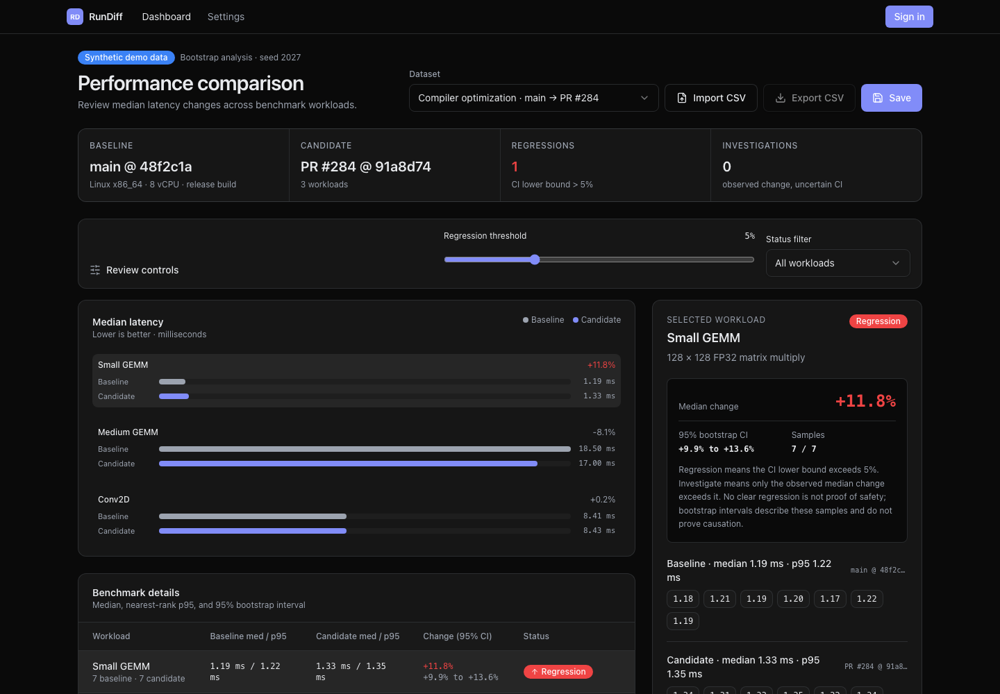
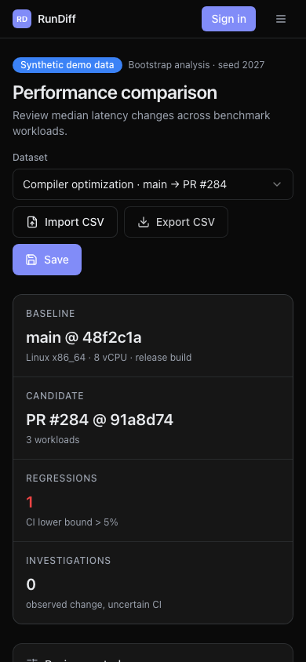
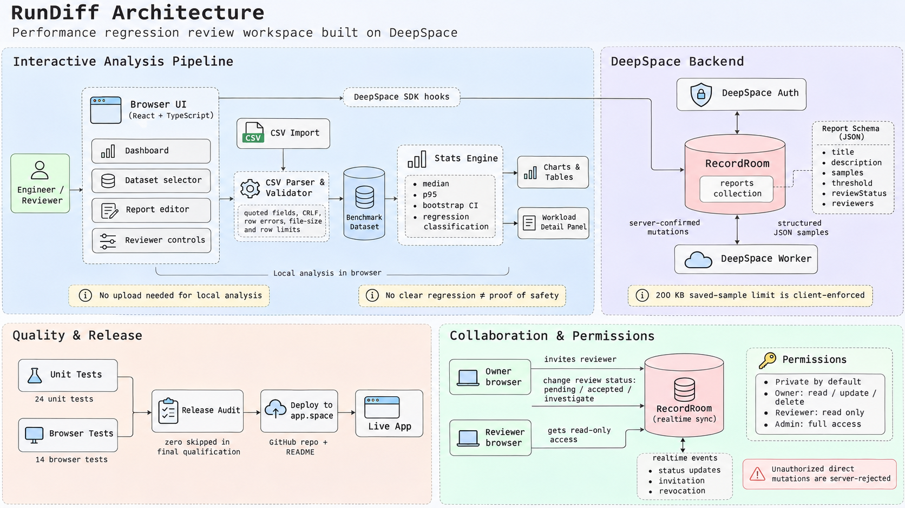

# RunDiff

RunDiff is a developer-focused dashboard for comparing repeated benchmark measurements before and after a code change. It calculates descriptive latency statistics, highlights potential regressions, imports local CSV files, and lets authenticated users save private reports for invite-only, read-only review.

The application is built with React, TypeScript, and DeepSpace 0.44.2. Demo data is synthetic and clearly labeled. Imported CSV data remains in the browser unless the user explicitly saves a report.

Live application: [rundiff-minh-2027.app.space](https://rundiff-minh-2027.app.space/home). The live release may lag behind this uncommitted M6 work until the owner deploys it.

## Screenshots

These screenshots were captured from the local dashboard with its built-in synthetic demo dataset, without signing in:





To reproduce them:

1. Run `npm run dev`.
2. Open `http://localhost:5173/home`.
3. Run `node scripts/capture-screenshots.mjs` (or set `RUNDIFF_BENCH_ORIGIN` to your local origin). The script captures 1440×1000 and 390×844 viewports.

The scaffold also provides `npm run screenshot`; inspect `npx deepspace test screenshot --help` for the installed CLI's current options.

## Features

- Two selectable synthetic benchmark datasets covering Small GEMM, Medium GEMM, and Conv2D workloads.
- Client-side CSV import with quoted fields, escaped quotes, CRLF input, row-numbered errors, and explicit file and row limits.
- Median latency, nearest-rank p95, percentage change, and deterministic bootstrap confidence intervals.
- Adjustable regression threshold and workload-status filtering.
- Immediate chart, table, summary, and measurement-detail updates.
- Browser-only CSV export of every workload's counts, medians, p95, median change, 95% interval, threshold, and classification, including for authorized report reviewers.
- Authenticated creation, reopening, editing, and deletion of private reports.
- Invite-only, read-only reviewers selected from DeepSpace's public user-directory projection.
- Realtime review-status updates and access revocation over the existing RecordRoom connection.
- Loading, empty, error, signed-out, and disconnected states.

## Architecture



RunDiff keeps calculation and parsing logic independent of the UI:

- `src/lib/benchmark-csv.ts` parses and validates local CSV input.
- `src/lib/benchmark-stats.ts` contains pure statistical functions.
- `src/lib/benchmark-worker.ts` calculates sample-dependent evidence off the browser's main thread; `src/lib/use-benchmark-evidence.ts` reuses evidence when only the threshold changes.
- `src/lib/analysis-export.ts` serializes analyzed workloads to CSV and starts a local download.
- `src/lib/reports.ts` converts validated datasets to and from persisted reports.
- `src/pages/(app)/home.tsx` provides the public analysis dashboard.
- `src/pages/(app)/(protected)/reports.tsx` provides authenticated report management and sharing.
- `src/schemas/reports-schema.ts` declares report storage and server-enforced permissions.

No mock API or custom database layer is used. Original measurements are stored in a DeepSpace JSON column and statistics are recalculated when a report is opened.

## DeepSpace primitives

- `DeepSpaceAuthProvider`, `useAuth`, and protected route groups for authentication.
- `RecordProvider` and `RecordScope` for the application data boundary.
- `useQuery` for live report subscriptions.
- `useMutations` confirmed mutations for server-acknowledged writes.
- `useRecordContext` for connection and mutation readiness.
- `useUsers` for the privacy-preserving public identity roster.
- Collection schemas with `createdBy`, `collaboratorsField`, and server-side role permissions.
- The existing RecordRoom WebSocket for realtime delivery and revocation.

See the [DeepSpace documentation](https://docs.deep.space/) for the platform model.

## Installation and local development

Prerequisites are Node.js 22.15–22.x (or another range accepted by `package.json`), npm 11.6 or newer, and access to the registered DeepSpace app.

```sh
npm install
npx deepspace auth login
npm run dev
```

The app normally starts at `http://localhost:5173`. Local DeepSpace secrets are managed by the CLI in the ignored `.dev.vars` file; do not commit that file.

## Testing

Run the release checks from the repository root:

```sh
npm run type-check
npm run test:unit
npm run lint
npm run build
npx deepspace test run all --port 5187
git diff --check
```

The authenticated browser suite requires two usable DeepSpace test accounts. Account credentials are managed by the DeepSpace test fixture and must not be placed in source files or command-line arguments. On a machine with the accounts already provisioned, run `npx --no-install deepspace test run all --port 5187` and inspect the passed, failed, and skipped counts. On a fresh machine, use `npx deepspace test accounts list` to check the local pool; see the [DeepSpace testing guide](https://docs.deep.space/guides/testing) for account provisioning and recovery. The `users(2)` fixture needs two usable accounts; its tests may skip without them. CI does not run or claim authenticated browser coverage.

## Continuous integration

`.github/workflows/ci.yml` runs on pull requests targeting `master` and pushes to `master`. It uses an Ubuntu runner, Node.js 22, npm 11.6.0, the committed lockfile (`npm ci`), and read-only GitHub permissions. It runs type-check, unit tests, lint, and the production build. It has no DeepSpace credentials and never deploys. A local pass is not evidence that GitHub Actions has run; check the repository's Actions tab for the actual result after the workflows are committed and pushed by the owner.

## CSV input format

CSV files must contain exactly these columns, in this order:

```csv
workload,variant,latency_ms
gemm_128,baseline,2.10
gemm_128,baseline,2.14
gemm_128,candidate,2.39
gemm_128,candidate,2.42
```

Rules:

- `variant` must be `baseline` or `candidate`.
- Every workload must contain at least one measurement for both variants.
- Latency must be finite and greater than zero.
- Duplicate rows are retained as independent measurements.
- Quoted fields, escaped quotes, LF, and CRLF are supported.
- Files are limited to 1,000,000 bytes and 10,000 data rows.
- Parsing is local; selecting a file does not upload it.

## Permissions and sharing

Reports are private by default. DeepSpace sets `createdBy`; the client does not supply an owner ID.

| Caller | Read | Create | Update | Delete |
| --- | --- | --- | --- | --- |
| Signed out | No | No | No | No |
| Viewer | No | No | No | No |
| Member | Own or invited | Yes | Own only | Own only |
| Admin | Yes | Yes | Yes | Yes |

The report schema uses `collaboratorsField: "reviewers"` with member `read: "shared"`, while member updates and deletes remain `"own"`. Invited reviewers therefore receive the report but cannot change its title, samples, threshold, review status, or reviewer list—even with a custom client. Admin access follows the scaffold's explicit administrative policy.

Revocation is sent over the active RecordRoom connection. A revoked reviewer loses the record without refreshing, and a new connection receives a fresh permission-filtered snapshot. There are no public sharing links.

## Statistical methodology

- Median is calculated from sorted samples; even-sized samples use the mean of the two central values.
- p95 uses the nearest-rank convention: `ceil(0.95 × n)`, clamped to the sample range.
- Median change is `((candidate median / baseline median) - 1) × 100`; positive values are slower.
- The 95% interval is a deterministic percentile bootstrap of the median change using independent baseline and candidate resampling, 2,000 iterations, and seed 2027.
- At least five samples per variant are required for bootstrap classification.
- **Regression:** the confidence interval's lower bound is strictly greater than the selected threshold.
- **Investigate:** the observed median change exceeds the threshold but the interval does not establish it.
- **No clear regression:** the threshold is not established. This is not proof of safety.
- **Insufficient data:** a variant lacks the required sample count or valid measurements.

These intervals describe the supplied samples under independent resampling assumptions. They do not prove causation, correct benchmark bias, or establish that the underlying measurements are independent.

Statistical evidence (medians, p95, change, interval) depends on the original measurements, seed, iteration count, and minimum sample count. RunDiff calculates that evidence once per dataset/options combination in a browser Worker and classifies it again when the threshold changes. Reimporting a file creates a new dataset even if its filename is unchanged. Saved reports recalculate evidence from persisted samples. The original median, percentile, resampling, seed, interval quantile, and strict threshold conventions are unchanged.

## Export analysis

Use **Export CSV** on the dashboard or an authorized saved report. The download contains every workload in the selected dataset, regardless of the current status filter. Values use their full JavaScript numeric representation rather than the rounded display values; missing intervals are written as `unavailable`. Text fields are quoted as needed, and potentially executable spreadsheet text is prefixed with an apostrophe. Filenames are sanitized. The browser creates and revokes a temporary object URL; exporting does not upload samples or change report permissions.

## Performance measurements

Measured in headless Chromium 159 on a MacBook Air with Apple M5 (10 cores), 24 GB RAM, macOS 26.6, and Node.js 22.23.4. Synthetic fixtures use a repeating 17-value baseline and 19-value candidate sequence. Times are one observed run in milliseconds, not a hardware-independent guarantee. “Legacy” repeats the original `analyzeWorkload` bootstrap for each threshold; “reuse” calculates evidence once and classifies it 15 times. Both modes run in a real browser.

| Samples per variant | CSV rows | Parse legacy / reuse | Initial analysis legacy / reuse | 15 thresholds legacy / reuse |
| ---: | ---: | ---: | ---: | ---: |
| 50 | 100 | 0.7 / 0.7 ms | 20.5 / 22.2 ms | 263.2 / 0.1 ms |
| 500 | 1,000 | 0.6 / 0.6 ms | 221.0 / 228.7 ms | 3,311.1 / <0.1 ms |
| 2,500 | 5,000 | 1.2 / 1.3 ms | 1,138.3 / 1,205.4 ms | 17,313.9 / <0.1 ms |
| 5,000 | 10,000 | 2.0 / 1.9 ms | 2,363.4 / 2,399.9 ms | 35,500.6 / <0.1 ms |

The 10,000-row fixture was 219,358 bytes, below the 1,000,000-byte import limit. Direct synchronous analysis delayed a browser timer by about 2.4 seconds at this size. In the optimized local UI, importing and rendering that fixture took 2,907.9 ms wall time while the largest observed 10 ms timer delay was 89.6 ms. Initial computation still takes roughly 2.4 seconds; the Worker improves main-thread responsiveness, not calculation speed. The original UI import was not separately timed before this change, so no before/after UI latency claim is made.

To reproduce with the local Vite server:

```sh
npx vite --port 5188 --strictPort --host 127.0.0.1
# In another terminal:
RUNDIFF_BENCH_LEGACY=1 node scripts/benchmark-browser.mjs
node scripts/benchmark-browser.mjs
```

The script measures parsing, initial analysis, threshold classification, timer delay, and the 10,000-row UI import with `performance.now()`. Run more trials on the target hardware before treating small timing differences as meaningful.

## Known limitations

- The 200 KB saved-sample limit is enforced by the RunDiff client, not by the DeepSpace server schema. DeepSpace 0.44.2 does not expose a supported structured-JSON byte-length constraint. A custom client can bypass this application limit; RunDiff never claims otherwise.
- CSV imports and unsaved analyses are temporary browser state.
- Exported CSV files are local downloads. Opening them in a spreadsheet can interpret cells differently; suspicious text is prefixed to reduce formula execution risk.
- Reports have no public links, team workspaces, or write-capable reviewer role.
- Browser-test accounts must already exist in the local DeepSpace test pool.
- The shared React and routing entry remains the largest client asset. Dashboard, reports, DeepSpace, and UI code are split into separate cached chunks; loading cost should be measured on the intended network before further optimization.

## Design tradeoffs

- Deterministic bootstrap output favors reproducible reviews over configurable randomness.
- Confirmed mutations delay success feedback until the server acknowledges a write.
- Original samples are persisted instead of derived statistics so reopened reports can be recalculated.
- The user directory exposes only DeepSpace's public identity projection; private user records and credentials are not queried.
- Comments were omitted because DeepSpace 0.44.2 does not provide a small native cross-collection rule that securely authorizes comment creation against a private parent report.
- CI is credential-free; the GitHub Actions deployment job is deliberately disabled until the owner approves the credential and environment controls described below.
- AI was excluded because benchmark classification is deterministic and does not require model inference.
- Payments were excluded because RunDiff has no paid workflow in this milestone.

## Future improvements

- Add a supported server-side structured-payload limit when the SDK exposes one.
- Add secure report-scoped comments if parent-record authorization becomes available without privileged custom internals.
- Add optional benchmark metadata such as environment, revision, and hardware fields.
- Profile and reduce the shared client runtime if real-user loading measurements show it materially affects the experience.
- Add longer-term report organization after the core private-review workflow is validated.

## Deployment

Deployment remains owner-controlled. The current app ID is `app_01M7TMX9F6CTP6JW00A80YTTN3`; `deepspace app source --json` reports GitHub repository `nhatminh06/rundiff` as authoritative. Under GitHub source, DeepSpace deploys the **local checkout**, including dirty or unpushed files. The release workflow therefore verifies `master`, the checked-out SHA, a clean tree, and the existing app/source before deployment; it does not create an app or change remotes. See [source control](https://docs.deep.space/guides/source-control.md) and [deployment](https://docs.deep.space/concepts/deployment.md).

`.github/workflows/deploy.yml` is manual-only (`workflow_dispatch`). Its release-checks job can run, but the production deployment job is hard-disabled. Do **not** treat a green checks job as a deployed release. Before enabling deployment, the owner must configure a GitHub `production` environment with required reviewers and a `master` deployment-branch restriction, review the workflow, and explicitly approve storing the production DeepSpace session in an environment-scoped `DEEPSPACE_SESSION` secret. The installed CLI's [CI guidance](https://docs.deep.space/cli-reference/overview.md) requires the contents of `~/.deepspace/session` for a headless job; it is a long-lived personal credential that can deploy as the owner. Do not use a test-account password, put the session in repository files or logs, or copy the short-lived token cache. The disabled workflow already contains the session-file setup and source checks but cannot execute them until deliberately enabled.

Until that decision, the owner can release manually from a reviewed, clean `master` checkout: run the release checks above, inspect `git status`, `git remote -v`, `npx --no-install deepspace app source --json`, and `npx --no-install deepspace status --json`, verify the app ID and GitHub repository, then run `npx --no-install deepspace deploy` only after separate release approval. Confirm success from the deploy command's live result, `npx --no-install deepspace status --json` (`live.serving`, release sequence, and URL), and a browser smoke check of the production landing page, demo dashboard, and authenticated report flow. A passing build alone does not establish a live release.
